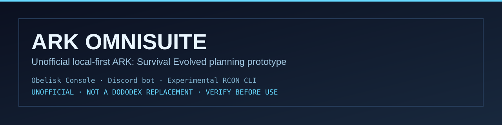
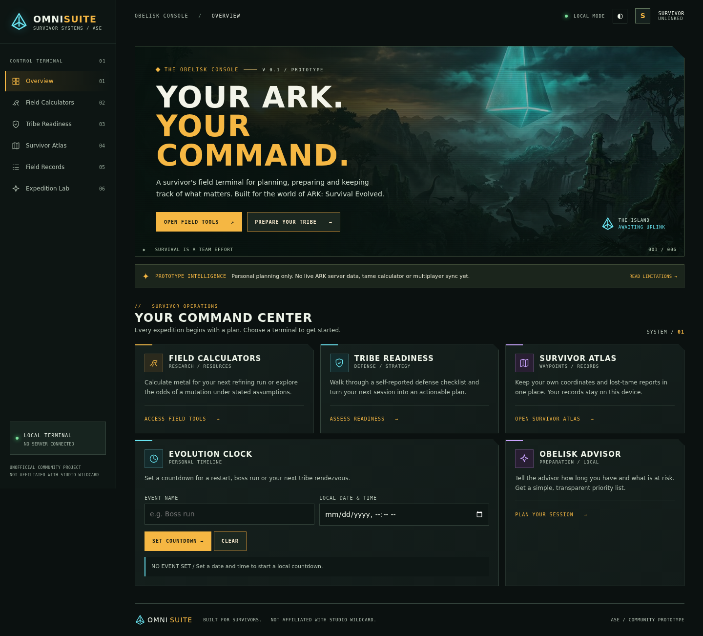
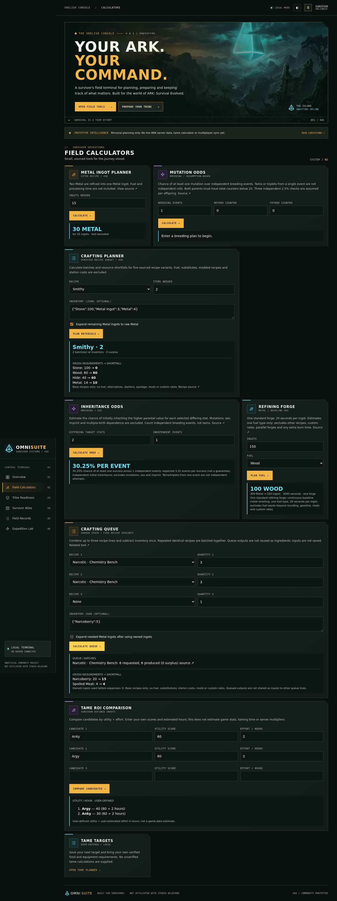
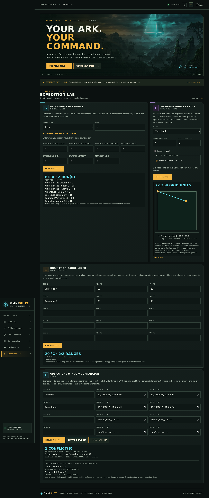
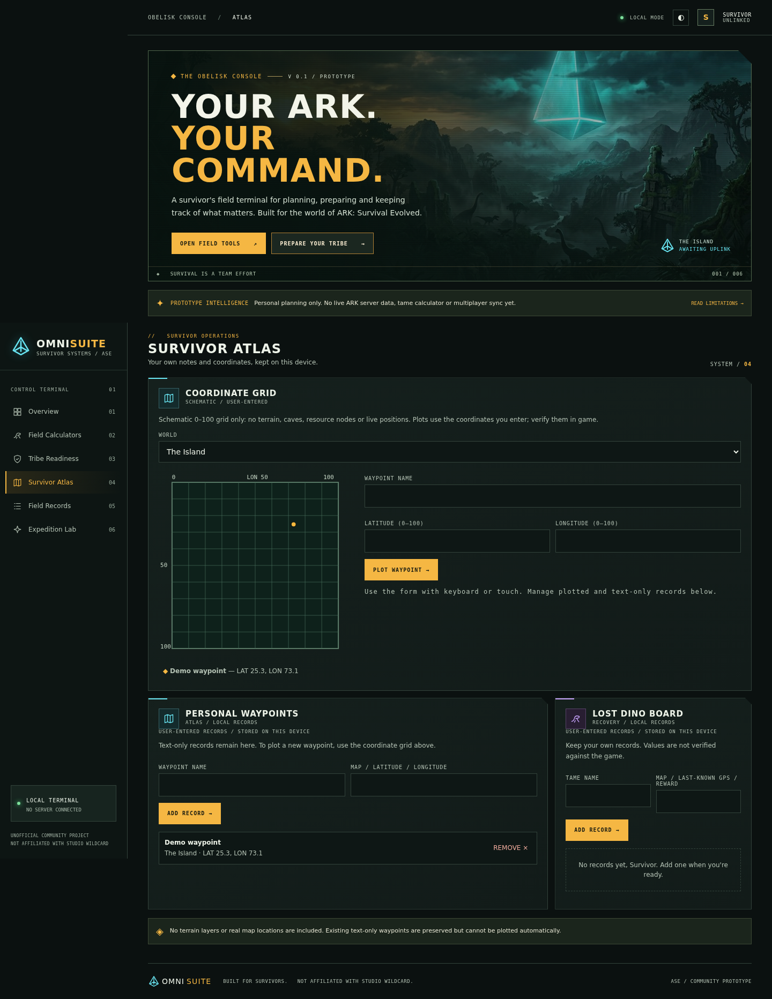
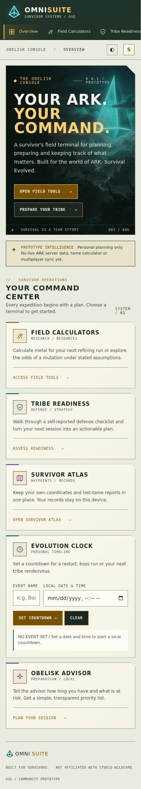

<div align="center">
  
</div>

# ARK OMNISUITE :: OBELISK CONSOLE

**Unofficial local-first ARK: Survival Evolved planning prototype — calculators, expedition prep, atlas records, operations windows, Discord bot, and experimental RCON CLI.**

<p align="center">
  
  
  
  
  <a href="https://github.com/Nortaq-PlayNexus/ark-omnisuite/actions/workflows/ci.yml"></a>
</p>

```text
┌──────────────────────────────────────────────────────────────────────────────┐
│ IDENT      ARK OMNISUITE / Obelisk Console                                   │
│ CLASS      Unofficial ARK planning prototype                                 │
│ STATUS     ◐ IN DEVELOPMENT — prototype, not complete                        │
│ STACK      Python stdlib · Vanilla HTML/CSS/JS · discord.py · SQLite         │
│ TARGET     Localhost / trusted private network                               │
│ LINK       https://github.com/Nortaq-PlayNexus/ark-omnisuite                 │
└──────────────────────────────────────────────────────────────────────────────┘
```

> [!WARNING]
> Unofficial fan project. Not affiliated with Studio Wildcard, Snail Games, Dododex, or A-Calc. Calculators are **limited and assumption-based**; verify against authoritative sources before relying on them. Do not expose the web app or RCON to the public Internet.

## // 01 :: SIGNAL

ARK OMNISUITE is a local-first planning workbench for ARK: Survival Evolved survivors and admins. It packages a small set of sourced calculators, local record boards, expedition prep, and coordination tools behind a Python stdlib web server, with a Discord bot and an experimental RCON CLI sharing the same core math.

This repo is intentionally honest: discovery is incomplete, novelty is not established, and unverified taming/stat engines were removed rather than guessed.

## // 02 :: CAPABILITIES

| Area | What works | Caveat |
|---|---|---|
| Ingot planner | 2 Metal → 1 Ingot | Fuel excluded; sourced to ARK Wiki |
| Mutation odds | ≥1 mutation probability when both parent counters < 20 | Simplified 3×2.5% independent roll model; other cases rejected |
| Breeding inheritance | Independent 55% higher-stat choice odds | No sex/mutation prediction; equal stats excluded |
| Forge fuel | Standard Refining Forge time/fuel for thatch/wood/sparkpowder/anglergel | Rounded needs; standard forge only |
| Crafting queue | Five sourced variants, batch rounding, shared stock subtraction | Not a full crafting tree |
| Expedition Lab | The Island Broodmother tribute requirements/shortfalls | Player level/gear/map variants not checked |
| Incubation mixer | Overlap from user-provided temperature ranges | No game incubation/egg health prediction |
| Atlas/records | Schematic coordinate grid, waypoints, lost dinos, lineage, boss checklist, tame targets | Local browser storage; schematic, not terrain map |
| Operations windows | UTC overlap check, Discord timestamp text | No local timezone conversion, no alerts/sending |
| Discord bot | 15 top-level commands + 5 `/plans` subcommands | Live Discord registration/interaction not tested |
| RCON CLI | Experimental local Source RCON command | Plaintext protocol; single response packet; simulated-server tests only |

## // 03 :: SCREENSHOTS

| Overview | Calculators |
|---|---|
|  |  |
| *Obelisk Console overview — local-first planning modules in one dashboard.* | *Sourced calculator subset with explicit assumptions and validation.* |

| Expedition Lab | Atlas |
|---|---|
|  |  |
| *Broodmother tribute planning with user-supplied inventory shortfalls.* | *Schematic coordinate grid and local waypoint ledger — not a terrain map.* |

<details>
<summary>Mobile screenshot</summary>

| Mobile |
|---|
|  |
| *Responsive layout at narrow viewport.* |

</details>

## // 04 :: QUICK START

Requires Python 3.11+.

```powershell
git clone https://github.com/Nortaq-PlayNexus/ark-omnisuite.git
cd ark-omnisuite
python -m unittest discover -s core/tests -v
python -m web.server --host 127.0.0.1 --port 8000
```

Open `http://127.0.0.1:8000`.

### Discord bot (optional)

```powershell
python -m pip install -r bot/requirements.txt
python -m bot.main --dry-run
# set DISCORD_TOKEN in your environment, then:
python -m bot.main
```

See [`docs/discord-bot.md`](docs/discord-bot.md) before live registration.

### RCON CLI (experimental)

```powershell
python -m core.rcon_cli --host YOUR_SERVER_HOST --port 27020
```

Only for ARK servers you administer. RCON is plaintext — use trusted private network/VPN. Never expose to the public Internet.

## // 05 :: ARCHITECTURE

```text
ark-omnisuite/
├─ core/          # Shared calculation logic, config, RCON, schedule, survivor tools
├─ web/           # Python stdlib server + vanilla public UI
├─ bot/           # Discord bot (discord.py), parsing, SQLite store
├─ tests/         # HTTP, bot, browser smoke tests
├─ docs/          # Verification, Discord bot docs, screenshots, assets
├─ plan/          # Product/spec/roadmap notes
└─ research/      # Inventory, analysis, feature ideas, workflow research
```

See [`docs/architecture.md`](docs/architecture.md).

## // 06 :: HONEST LIMITATIONS

- **Not complete.** No verified taming/KO/breeding timer/stat extractor datasets; no full crafting tree; no live-server verification.
- **Not Dododex/A-Calc parity.** Reference comparisons require consistent game/rate settings; this prototype does not claim parity.
- **RCON is experimental.** Simulated-server tests only; single response packet; plaintext protocol; no web/Discord exposure.
- **Discord bot live behavior untested.** Dry-run and mocked tests pass; live Discord registration/permissions/delivery not verified.
- **Atlas is schematic.** No game terrain, no verified locations, no licensed map layers.
- **Browser storage is local.** Records stay in browser local storage; export JSON for backup. Import replaces existing records.
- **No WCAG certification.** Automated axe checks were run on selected views; manual accessibility review still needed.
- **Unofficial.** Not affiliated with Studio Wildcard, Snail Games, or ARK trademark holders.

## // 07 :: SECURITY / LEGAL

- Do not expose the web prototype publicly; it has no authentication.
- RCON password/commands are plaintext. Restrict port, use private network/VPN, administer only servers you own/operate.
- Discord bot token and note DB must be secured by the operator; notes are plaintext on bot host.
- Use only on servers/accounts/data you are authorized to access.

See [`SECURITY.md`](SECURITY.md).

## // 08 :: DOCS / RELEASE

- [Architecture](docs/architecture.md)
- [Development](docs/development.md)
- [Deployment](docs/deployment.md)
- [Security](docs/security.md)
- [API](docs/api.md)
- [Discord bot](docs/discord-bot.md)
- [Verification](docs/verification.md)
- [Changelog](CHANGELOG.md)
- [Research inventory](research/01-inventory.md)
- [Product spec / roadmap](plan/03-product-spec.md)

## // 09 :: LICENSE

[MIT](LICENSE) © 2026 DJ PhantomTape / Nortaq-PlayNexus.

ARK: Survival Evolved and related marks are property of their respective owners. This project is an unofficial fan prototype.
