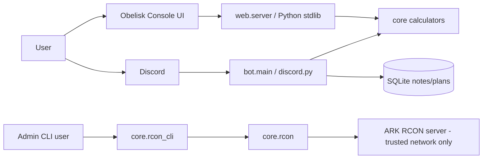

# Architecture

## Components

| Component | Path | Role |
|---|---|---|
| Core math/domain | `core/` | Sourced calculators and planners: breeding, crafting, forge, mutation, ROI, schedule, survivor tools, config. |
| RCON CLI | `core/rcon.py`, `core/rcon_cli.py` | Experimental Source RCON client; local CLI only. |
| Web server | `web/server.py` | Python stdlib HTTP server exposing calculator/API endpoints and serving static UI. |
| Web UI | `web/public/` | Vanilla HTML/CSS/JS Obelisk Console: overview, calculators, operations, atlas, boards, expedition. |
| Discord bot | `bot/` | discord.py command handlers, parsing, SQLite note/plan storage. |
| Tests | `core/tests/`, `tests/` | Unit tests, HTTP tests, bot parser/storage/mocked interaction tests, browser smoke. |
| Research/plan | `research/`, `plan/` | Discovery inventory, analysis, roadmap/spec; intentionally includes incomplete items. |

## Data flow

## Boundaries

- Web app is unauthenticated and intended for localhost/trusted local use.
- RCON is plaintext and never exposed through web or Discord surfaces.
- Discord bot notes are private by user+context intent but stored plaintext on bot host.
- Browser records live in localStorage; export/import is user-managed.
- Calculators reject unsupported/unknown cases rather than guessing.
